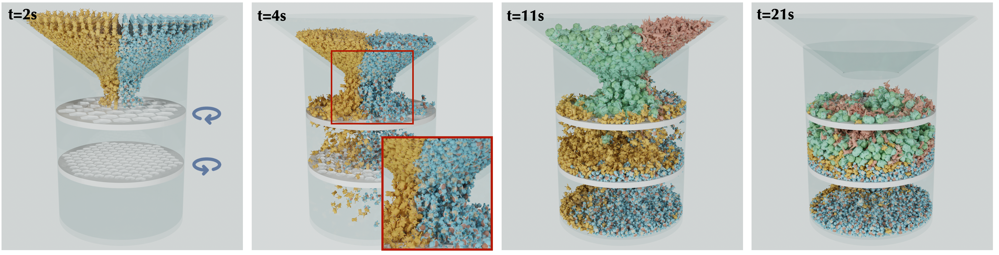

# 分布式仿射体动力学与自适应共识 (Distributed Affine Body Dynamics with Adaptive Consensus)



## 一段话概览

本论文（SIGGRAPH 2026 Conference Papers，arXiv 2605.15875）提出了一个**分布式的仿射体动力学 (ABD) 仿真框架**。ABD 在 IPC (Incremental Potential Contact) 框架下能精确仿真近刚性的极硬物体并严格保证无穿透，但 IPC 的对数障碍 (log-barrier) 接触约束在所有相互作用物体之间是**全局耦合**的，使得朴素的区域分解失效，单机求解器无法扩展到数千万到数亿接触候选对的大规模场景。作者把分布式 ABD 重新表述为一个**共识优化 (consensus optimization) 问题**，用**共识 ADMM** 求解：场景被划分给多个 worker，界面附近的物体被复制成"共享物体"并通过共识协调。三项核心贡献是：(1) 基于 ADMM 的分布式 ABD 框架，保持 IPC 级别的无穿透；(2) **质量感知 (mass-aware) 的惩罚参数初始化 + 残差驱动的自适应**，显著加速收敛；(3) **无穿透共识更新**——把共识状态 $z$ 当作中间估计，仅在终止时用对合并目标的 CCD 检查 (TOI=1) 来保证最终可行性。

## 难度等级

**Advanced（进阶）** — 主题为 **分布式优化 + 物理仿真** 的交叉。需要同时具备数值优化（ADMM、增广拉格朗日、共识优化、原始/对偶残差）和物理仿真（ABD 的 12 自由度刚体表示、IPC 障碍能量、连续碰撞检测 CCD）两方面的背景知识。

## 如何使用本学习包（推荐顺序）

1. **`mental-model.md`** — 先建立"这是一类什么问题"的心智模型，明确所需前置知识与它在大图景中的位置。
2. **`summary.md`** — 通读背景、问题、三项贡献与关键数据，掌握全貌。
3. **`insights.md`**（最重要、最深入）— 真正理解三个"为什么"：为什么质量感知惩罚有效、为什么 CCD-on-merge-target 既必要又优雅、共识状态作为中间量的概念转变。
4. **`method.md`** — 逐式拆解共识 ADMM 数学（式 2–12）、Algorithm 1 伪代码、无穿透 CCD 合并流程、质量感知与残差驱动 $\rho$ 自适应、PD 负载均衡控制器，以及复现陷阱。
5. **`code/`** — 运行两个独立可执行的 numpy 教学 demo，亲手观察共识收敛与质量感知惩罚的效果。
6. **`index.html`** — 交互式探索器：worker 扩展性仪表板、共识收敛可视化、分区/CCD 合并机制图、大规模结果表。
7. **`qa.md`** — 15 道分级自测题（5 基础 / 5 中级 / 5 进阶）。
8. **`reflection.md`** — 扩展方向、开放问题与脆弱假设的批判性思考。

## 关键要点 (Key Takeaways)

- IPC 障碍约束的**全局耦合**是分布式 ABD 的根本障碍；共识优化是处理"跨分区共享状态需一致"的自然范式。
- **质量感知惩罚**的洞见：ARAP 缩放模态特征值可达 $10^8$、IPC 障碍特征值在接近接触时爆炸，二者都**高估**有效刚度；而惯性块满足 $\lambda_{\max}(M_{i,b}) \le m_b$，故用物体质量 $m_b$ 作为干净、稳定的刚度代理。
- **无穿透共识**的洞见：局部解保证无穿透，但共识 $z$ 可能互穿；解法是把 $z$ 视为估计，仅在收敛时对"用 $z$ 替换共享体后的合并目标"沿轨迹做 CCD，全部 worker 报告 TOI=1 才接受 $q_{t+1}=z$。
- **残差驱动自适应**使 ADMM 迭代数在各密度等级下减少 **22%–80%**；方法在 2、4 worker 下接近线性加速，8 worker 时因跨分区耦合增强降到约 6×。
- 大规模能力："Pokémon"场景 5.2K 物体 / 5.7M 三角形 / 59.8M 候选对仍保持无穿透；"Parts and Robotic Arm"单 GPU 因显存不足无法运行（加速比记为 ∞）。

## 估计学习时间

- 快速通读（README + summary + mental-model）：约 **45 分钟**
- 深入研读（insights + method + 运行 code demo）：约 **3–4 小时**
- 完整精读（含 qa 自测 + reflection + 交互式 index.html + 对照原文）：约 **6–8 小时**

## 目录结构

```
distributed-affine-body-dynamics/
├── README.md            # 本文件：总览与导航
├── summary.md           # 背景、问题、贡献、关键结果
├── insights.md          # 最深入：核心思想与三个"为什么"
├── method.md            # 方法细节：数学、算法、复现陷阱
├── mental-model.md      # 心智模型与前置知识
├── qa.md                # 15 道分级自测题
├── reflection.md        # 扩展、开放问题、脆弱假设
├── code/
│   ├── consensus_admm_demo.py        # 共识 ADMM 代理问题教学 demo
│   └── mass_aware_penalty_demo.py    # 质量感知惩罚 vs 刚度代理 demo
├── images/
│   └── teaser_pokemon.png            # 论文 teaser（占位）
└── index.html           # 交互式探索器（单文件，无外部依赖）
```
