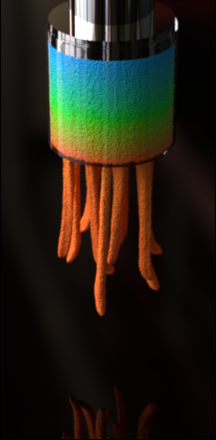

# MPM Lite：线性核与无粒子积分（学习资料包）



## 一句话概览

**MPM Lite**（SIGGRAPH 2026，arXiv 2602.07853）提出了一种新的混合 Lagrangian/Eulerian 离散方案：它把传统物质点法（MPM）中"粒子既是状态载体、又是求解期的积分点（求积点）"这一耦合彻底拆开——粒子退化为**仅携带运动学状态 $(x,v,F,G)$ 与材料历史的"信使"**，求解时通过紧致的线性/多线性 $Q_1$ 核把粒子状态**重采样到固定的网格胞心求积点**，再把整个力装配与时间积分（显式或隐式）放到网格上完成（等价于体素六面体网格上的**单点六面体有限元 FEM**），全程**不再访问粒子**。由此，隐式求解的复杂度与每胞粒子数（PPC）解耦，得到对实用弹塑性材料相对显式 MPM **1.88×**、相对隐式 MPM **最高 15.9×** 的加速。

## 难度等级

**Advanced（高度理论 + 架构）。** 本文不是一个"小技巧"论文，而是对 MPM 计算范式的一次结构性重构。要真正读懂，需要同时掌握连续介质力学（应力/应变、变形梯度、极分解）、有限元弱形式与求积、APIC 传输理论、以及基于优化的隐式时间积分（增量势）。核心洞见——"为什么不能平均 $F$、而必须重采样广延量 $V\tau$"——需要对**强度量 / 广延量（intensive/extensive）**有清晰理解。

## 如何使用这套资料

建议阅读顺序：

1. **`summary.md`** —— 先建立全局：背景、问题陈述（"MPM 粒子必须是求积点吗？"）、三条贡献、关键定量结果。
2. **`mental-model.md`** —— 在深入细节前，先把这篇工作放进你已有的知识地图（MPM↔FEM、FLIP/PIC 类比），明确需要的前置知识。
3. **`insights.md`**（**最重要**）—— 用通俗语言讲清核心思想，并解释**为什么它成立**（广延 Kirchhoff 应力是正确的重采样对象、旋转无关的拉伸重建、$O(dx^2)/O(dt^2)$ 误差保证）。这是整套资料的灵魂。
4. **`method.md`** —— 逐式拆解：运动学传输、应力传输、变身 FEM、增量势、StVK-Hencky 与 split Neo-Hookean 的拉伸重建闭式解，附 Algorithm 1–4 伪代码与数据流 ASCII 图，以及实现陷阱。
5. **`code/`** —— 两个可独立运行的 numpy 教学 demo：
   - `stress_transfer_demo.py`：演示"平均 $F$ 是错的、重采样 $V\tau$ 是对的"，并验证 StVK-Hencky 拉伸重建 $\tau\to\sigma_i$ 的往返一致性。
   - `mpm_lite_1d_demo.py`：在极小网格上跑完整的 Unload→Integrate(显式)→Load 循环。
6. **`index.html`** —— 交互式探索器（PPC 加速曲线、load/unload 流水线动画、与传统方法的对比矩阵），用论文真实数据。
7. **`qa.md`** —— 15 道自测题（5 基础 / 5 进阶 / 5 高级），检验理解。
8. **`reflection.md`** —— 批判性延伸：脆弱假设、开放问题、可能失效的场景。

## 关键收获（Key Takeaways）

- **粒子不必是求积点。** 这是全文的"撬动点"。把求积从移动粒子搬到固定胞心，求解复杂度立刻与 PPC 脱钩。
- **不能平均变形梯度 $F$。** $F$ 既非强度量也非广延量，混合不同的旋转/拉伸会破坏应力状态。正确做法是重采样**广延的 Kirchhoff 应力含量 $V\tau$**，它满足 $\sum_c V_c\tau_c=\sum_p V_p\tau_p$。
- **旋转无关的拉伸重建。** 对各向同性超弹性材料，一步后向 Euler 内能量与刚度只依赖拉伸 $S$（$F=RS$），与旋转无关；丢弃旋转带来的速度误差仅 $O(dt^2)$。由此可从 $\tau_c$ 闭式反演出 $F_{\text{base}}=S_c$。
- **MPM 变成即插即用的 FEM。** 隐式求解就是标准六面体 FEM 增量势优化，可直接套用现成的 PCG、multigrid、VBD 求解器，边界条件清晰无歧义。
- **线性核 + gather 传输。** 常数权重 $w_{ic}=2^{-d}$，纯 gather，无写竞争，天然可并行。

## 预计学习时间

- 快速通读（summary + insights）：**约 1.5 小时**
- 深入研读（method + 跑通两个 demo + 玩 index.html）：**额外 4–6 小时**
- 复现级别（推导拉伸重建、实现 3D Cardano 分支选择）：**1–2 天**

## 目录结构

```
papers/mpm-lite/
├── README.md            # 本文件：总览与导航
├── summary.md           # 背景、问题、贡献、结果
├── insights.md          # 核心洞见（最深入，最重要）
├── method.md            # 方法逐式拆解 + 算法伪代码 + 数据流图
├── mental-model.md      # 心智模型与前置知识
├── qa.md                # 15 道自测题
├── reflection.md        # 批判性反思与延伸
├── code/
│   ├── stress_transfer_demo.py   # 应力传输与拉伸重建 demo
│   └── mpm_lite_1d_demo.py       # 完整 Unload→Integrate→Load 循环 demo
├── images/
│   └── teaser.png       # 论文 teaser 图（需自行放入）
└── index.html           # 交互式探索器
```
